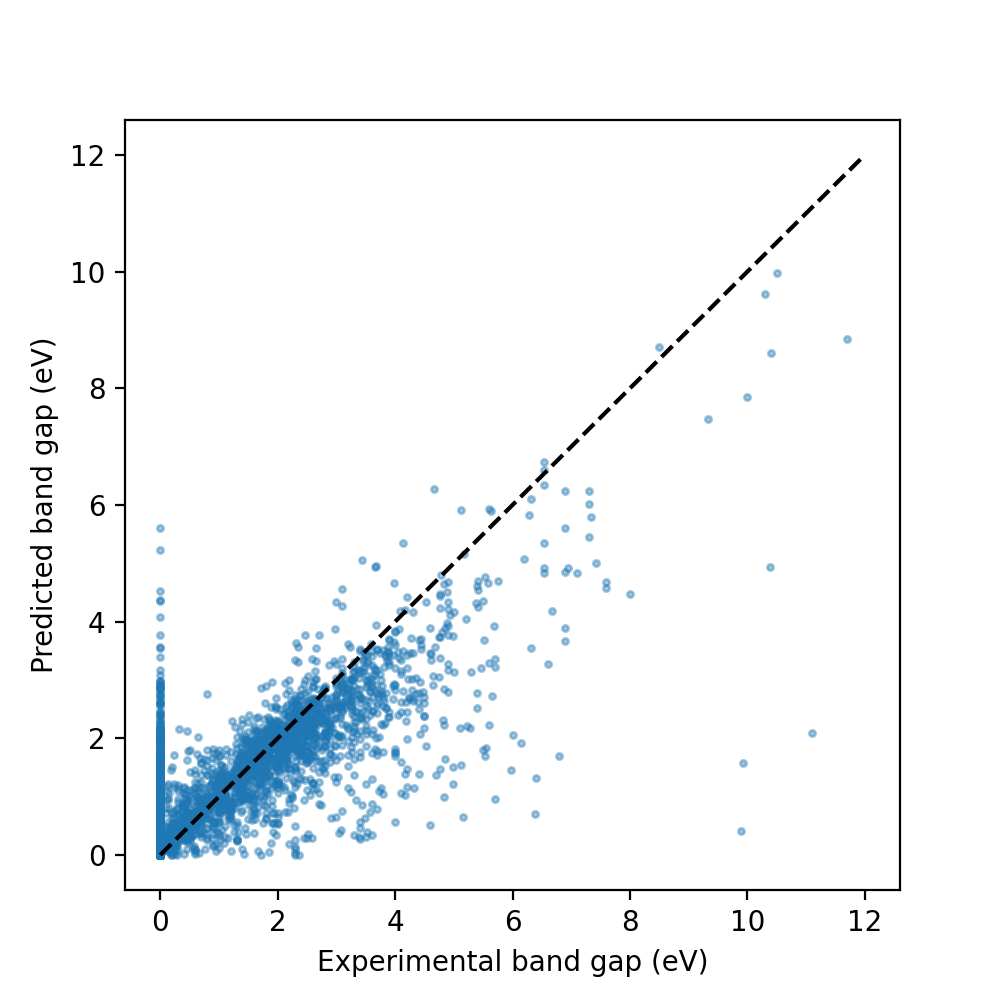
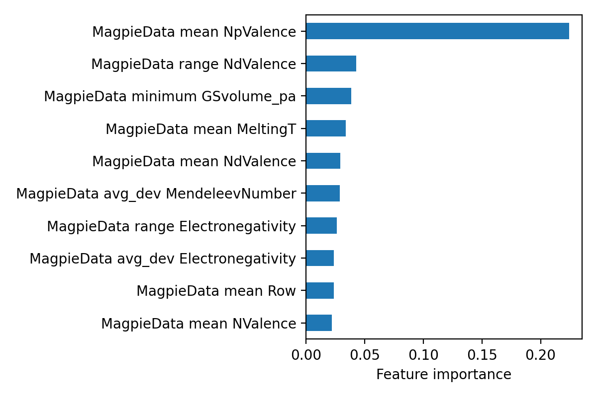

# Band Gap Prediction from Composition

Predicting the **experimental band gap** of inorganic compounds using only their chemical formula, with a random forest trained on Magpie elemental features.

## Summary

| Model | MAE (eV) |
| --- | --- |
| Baseline: predict 0 for everything | 0.976 |
| Baseline: predict the mean for everything | 1.143 |
| **Random forest + Magpie features (5-fold CV)** | **0.446** |

The model cuts the error by about 54% compared with the best naive baseline.

## Data

- **Dataset**: `matbench_expt_gap` from [Matbench](https://matbench.materialsproject.org/), loaded with [matminer](https://hackingmaterials.lbl.gov/matminer/)
- **Size**: 4,604 inorganic compounds (formula → experimental band gap in eV)
- **Distribution**: 53% of compounds are metals (band gap = 0). The largest gap is LiF (11.7 eV), and the top entries are mostly fluorides (MgF₂, NaF, KF, CaF₂) and BeO.

## Method

1. **Featurization**: Converted each formula into 132 composition-based descriptors (Magpie preset: 22 elemental properties × 6 statistics such as mean, range, and minimum)
2. **Baselines**: Predict 0 or the mean for every compound
3. **Model**: Random forest regression (300 trees)
4. **Evaluation**: 5-fold cross-validation, mean absolute error (MAE)

## Results

### Predicted vs. experimental band gap

- Metals (true gap = 0) are often predicted above zero, sometimes up to ~5.8 eV.
- Wide-gap compounds (> 9 eV) are underestimated.
- Both are signs of **regression toward the mean**: a random forest averages many trees and cannot extrapolate beyond the training range, and wide-gap examples are rare.

### Feature importance

| Rank | Feature | Importance |
| --- | --- | --- |
| 1 | mean NpValence | 0.224 |
| 2 | range NdValence | 0.043 |
| 3 | minimum GSvolume_pa | 0.039 |
| 4 | mean MeltingT | 0.034 |
| 5 | mean NdValence | 0.029 |

**Chemical interpretation**

- **Mean number of p valence electrons** dominates. It reflects the fraction of electronegative p-block elements (halogens, O, N), which form anions that hold electrons tightly. This feature effectively separates metals (gap = 0, 53% of the data) from ionic compounds.
- **Range of d valence electrons** flags transition metals, whose partially filled d bands tend to make compounds metallic or narrow-gap.
- **Minimum atomic volume** and **mean row (period)** suggest that small, light elements give wider gaps, consistent with the trend C (diamond) > Si > Ge > Sn.
- Electronegativity difference also appears in the top 10. Its importance is likely shared with correlated features such as NpValence.

Note: impurity-based importance shows what the model relies on, not causation.

## Limitations

- **Composition only**: Polymorphs with the same formula but different structures (and band gaps) cannot be distinguished.
- **Zero-inflated target**: Half the data are metals, which a single regression model handles poorly.
- **Measurement variation**: Experimental values come from different sources and methods.

## Next Steps

- Two-stage model: classify metal vs. non-metal first, then regress the band gap of non-metals
- Permutation importance to check the feature ranking
- Compare with other models (e.g., gradient boosting)

## How to Run

Open `bandgap_ml.ipynb` in Google Colab and select **Runtime → Run all**. Results are reproducible with `random_state=0`.

## What I Learned

- How to turn a chemical formula into numerical features a model can learn from
- Why a model must be compared against a baseline, and why the best baseline depends on the metric (for MAE, the median rather than the mean)
- How to read model errors and feature importance in terms of chemistry

## References

- Dunn, A. et al. Benchmarking materials property prediction methods: the Matbench test set and Automatminer reference algorithm. *npj Comput. Mater.* 6, 138 (2020).
- Ward, L. et al. A general-purpose machine learning framework for predicting properties of inorganic materials. *npj Comput. Mater.* 2, 16028 (2016).
- Ward, L. et al. Matminer: An open source toolkit for materials data mining. *Comput. Mater. Sci.* 152, 60–69 (2018).
