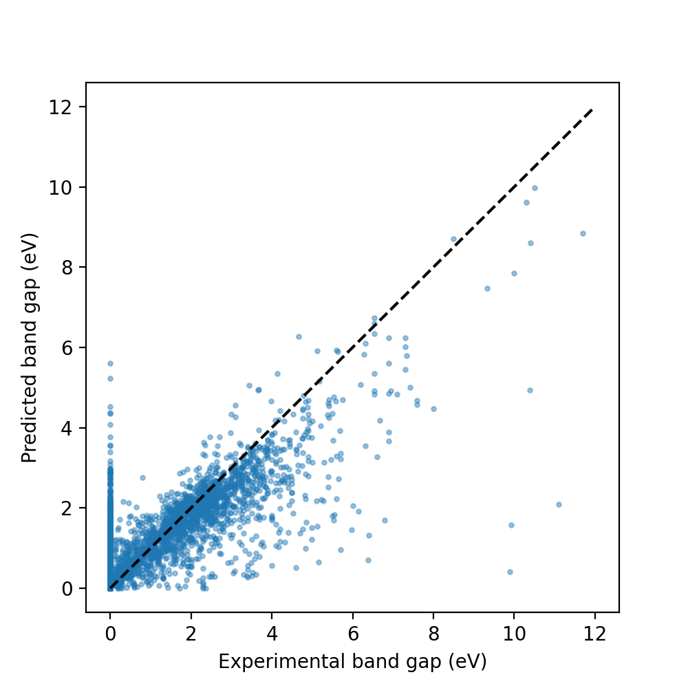
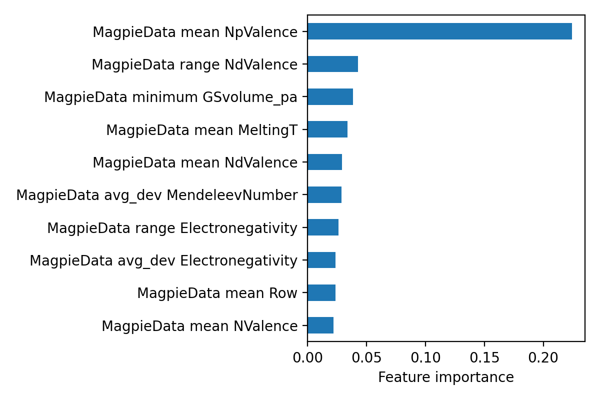

# 화학식만으로 밴드갭 예측하기

무기 화합물의 **실험 밴드갭(experimental band gap)**을 화학식 정보만 가지고 예측했다. Magpie 원소 특징(Magpie elemental features)과 랜덤 포레스트(random forest)를 사용했다.

## 요약

| 모델 | MAE (eV) |
| --- | --- |
| 기준선(baseline): 전부 0으로 예측 | 0.976 |
| 기준선: 전부 평균값으로 예측 | 1.143 |
| **랜덤 포레스트 + Magpie 특징 (5-fold 교차검증)** | **0.446** |

가장 나은 단순 기준선보다 오차를 약 54% 줄였다.

## 데이터

- **데이터셋**: [Matbench](https://matbench.materialsproject.org/)의 `matbench_expt_gap`, [matminer](https://hackingmaterials.lbl.gov/matminer/)로 불러옴
- **크기**: 무기 화합물 4,604개 (화학식 → 실험 밴드갭, 단위 eV)
- **분포**: 53%가 금속(metal, 밴드갭 = 0)이다. 밴드갭이 가장 큰 물질은 LiF(11.7 eV)이고, 상위권은 대부분 플루오린화물(fluoride: MgF₂, NaF, KF, CaF₂)과 BeO다.

## 방법

1. **특징 만들기(featurization)**: 화학식 하나를 숫자 132개로 바꿨다. Magpie 설정은 원소 물성 22가지 × 통계값 6가지(평균, 범위, 최솟값 등)다.
2. **기준선(baseline)**: 모든 물질을 0 또는 평균값으로 찍었을 때의 성능을 먼저 쟀다.
3. **모델**: 랜덤 포레스트 회귀(random forest regression), 결정 나무 300그루
4. **평가**: 5-fold 교차검증(cross-validation), 평균절대오차(MAE, mean absolute error)

## 결과

### 실험값 vs 예측값

- 금속(실제 밴드갭 = 0)을 0보다 크게 예측하는 경우가 많다. 최대 약 5.8 eV까지 예측했다.
- 밴드갭이 큰 물질(9 eV 이상)은 실제보다 작게 예측된다.
- 둘 다 **평균 쪽으로 끌려가는 현상(regression toward the mean)**이다. 랜덤 포레스트는 나무 여러 그루의 예측을 평균 내고, 학습 범위 밖으로 외삽(extrapolation)하지 못한다. 밴드갭이 큰 예시도 적다.

### 특징 중요도(feature importance)

| 순위 | 특징 | 중요도 |
| --- | --- | --- |
| 1 | mean NpValence | 0.224 |
| 2 | range NdValence | 0.043 |
| 3 | minimum GSvolume_pa | 0.039 |
| 4 | mean MeltingT | 0.034 |
| 5 | mean NdValence | 0.029 |

**이름 읽는 법**: `MagpieData [통계값] [원소 물성]`

- mean = 조성 가중 평균, range = 최댓값 − 최솟값, minimum = 최솟값, avg_dev = 평균 절대 편차
- NpValence = p 오비탈 원자가 전자 수, NdValence = d 오비탈 원자가 전자 수, GSvolume_pa = 원자 하나당 부피, MeltingT = 녹는점, Row = 주기

**중요도 숫자의 뜻**: 132개 특징의 점수를 모두 더하면 1이다. 0.224는 모델이 오차를 줄이는 데 쓴 전체 기여 중 약 22%를 그 특징이 담당했다는 뜻이다. 단위는 없고, 특징끼리 비교할 때만 쓴다.

**화학적 해석**

- **평균 p 원자가 전자 수**가 압도적인 1위다. 할로젠, O, N처럼 전기음성도가 큰 p-블록 원소의 비율을 나타낸다. 이런 원소는 음이온이 되어 전자를 꽉 붙잡는다. 예: LiF = (0 + 5)/2 = 2.5, Cu 금속 = 0. 이 특징이 데이터의 53%인 금속(밴드갭 0)과 이온성 화합물을 가르는 역할을 한 것으로 보인다.
- **d 원자가 전자 수의 범위**는 전이금속이 들어 있다는 신호다. 부분적으로 채워진 d 오비탈은 페르미 준위(Fermi level) 근처에 띠를 만들어 금속이 되거나 밴드갭이 작아지기 쉽다.
- **최소 원자 부피**와 **평균 주기(Row)**는 작고 가벼운 원소일수록 밴드갭이 크다는 경향과 맞는다. 탄소(다이아몬드) > Si > Ge > Sn 순서로 밴드갭이 줄어드는 것과 같다.
- **전기음성도 차이**도 상위 10위 안에 들었다. NpValence처럼 서로 상관관계가 높은 특징과 중요도를 나눠 가져서 순위가 낮아 보이는 것 같다.

주의: 불순도 기반 중요도(impurity-based importance)는 모델이 무엇을 많이 썼는지 보여줄 뿐, 원인(인과관계)을 증명하지 않는다. 증가/감소 방향도 알려주지 않는다.

## 한계

- **조성만 사용**: 화학식은 같지만 결정 구조가 다른 동질이상(polymorph)은 밴드갭이 달라도 구분할 수 없다.
- **0이 많은 데이터(zero-inflated)**: 절반이 금속이라 회귀 모델 하나로는 다루기 어렵다.
- **측정 차이**: 실험값은 출처와 측정 방법이 제각각이다.

## 다음 단계

- 2단계 모델: 먼저 금속/비금속을 분류(classification)하고, 비금속만 밴드갭을 회귀(regression)로 예측
- 순열 중요도(permutation importance)로 특징 순위 재확인
- 다른 모델(예: 그래디언트 부스팅, gradient boosting)과 비교

## 실행 방법

`bandgap_ml.ipynb`를 Google Colab에서 열고 **런타임 → 모두 실행**을 누른다. `random_state=0`으로 고정해서 실행할 때마다 같은 결과가 나온다(재현성, reproducibility).

## 배운 점

- 화학식을 모델이 학습할 수 있는 숫자(특징)로 바꾸는 방법
- 모델은 반드시 기준선과 비교해야 한다. 그리고 가장 좋은 기준선은 평가 지표에 따라 다르다. MAE에서는 평균이 아니라 중앙값(median)이 최적이고, 이 데이터는 중앙값이 0이라 "전부 0"이 더 나은 기준선이었다.
- 모델의 오차와 특징 중요도를 화학 지식으로 해석하는 방법
- 데이터 누출(data leakage): 정답 열을 입력에 넣으면 모델이 답을 베끼므로 반드시 빼야 한다.

## 참고문헌

- Dunn, A. et al. Benchmarking materials property prediction methods: the Matbench test set and Automatminer reference algorithm. *npj Comput. Mater.* 6, 138 (2020).
- Ward, L. et al. A general-purpose machine learning framework for predicting properties of inorganic materials. *npj Comput. Mater.* 2, 16028 (2016).
- Ward, L. et al. Matminer: An open source toolkit for materials data mining. *Comput. Mater. Sci.* 152, 60–69 (2018).
